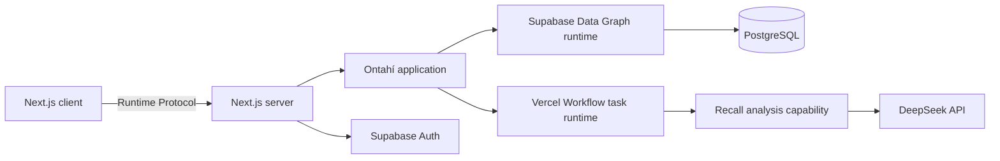

# Arquitectura, stack y seguridad

## Release de Ontahí

El proyecto fija el release alpha más reciente en versiones exactas:

```text
@ontahi/* 1.0.0-alpha.13
```

No se usa el tag npm `latest`, porque actualmente todavía apunta a `0.1.0-alpha.0`. Los paquetes se
actualizan de manera coordinada y deliberada.

## Stack objetivo

```text
Next.js App Router            interfaz y host server-side
Ontahí                        entidades, relaciones, Operations y policies
@ontahi/runtime-nextjs        bridge y Runtime Protocol
@ontahi/supabase              Data Graph sobre Supabase/PostgreSQL
Supabase Auth                 invitaciones y magic links
Vercel                        hosting y deployment
@ontahi/runtime-vercel-workflows
                              durable operations
DeepSeek                      proveedor inicial de análisis
```

El proveedor de LLM queda detrás de una capability intercambiable. La suscripción personal de
ChatGPT/Codex no se usa como API.

## Perfiles de runtime

### Desarrollo local inicial

```text
Next.js App Router
Ontahí 1.0.0-alpha.13
in-memory Data Graph runtime
in-process Task runtime
DevPrincipalProvider
FakeRecallAnalysisModel
```

No requiere cuentas, secrets, servicios remotos ni deployment. Los datos se reinician al reiniciar
el proceso, lo cual es aceptable durante la construcción de los flujos principales.

### Producción posterior

```text
Next.js en Vercel
Supabase Data Graph runtime
Supabase Auth principal provider
Vercel Workflow task runtime
DeepSeekRecallAnalysisModel
```

La aplicación y sus Operations no cambian entre perfiles; cambia la composición de runtimes y
capabilities del host.

## Componentes



## Navegación y comportamiento

Las URLs identifican superficies navegables:

```text
/admin/experiments
/admin/experiments/:experimentId
/e/:publicToken
```

Las intenciones son Operations y se invocan por el bridge. No se diseñan endpoints REST específicos
para publicar, cerrar o analizar.

## Autenticación de administradores

El registro público se deshabilita. El owner invita un email mediante una Operation server-side que
crea una `AdminInvitation` y llama a Supabase Auth Admin.

La primera integración ya usa sesiones SSR de Supabase y magic links con `shouldCreateUser: false`.
El host proyecta cada sesión válida como Principal de Ontahí; las Operations administrativas exigen
ese Principal y las lecturas anónimas se limitan al flujo participante. La administración de
invitaciones y Memberships persiste como el siguiente incremento de este slice.

Al aceptar:

1. Supabase verifica el email y crea la sesión.
2. El host deriva un Principal desde la sesión confiable.
3. La aplicación busca una invitación pendiente para el mismo email normalizado.
4. Se crea la Membership con el rol persistido por la invitación.

Los roles de autorización no se leen de `user_metadata` ni de valores enviados por el navegador.

### Identidad durante el desarrollo local

Antes de integrar Supabase Auth, `DevPrincipalProvider` proyecta identidades sembradas para el owner,
admins y viewer. Una herramienta visible sólo en desarrollo permite seleccionar el actor actual.

Este selector no evita las policies: cambia el Principal de desarrollo que llega al invocation
context, y las Operations siguen autorizándose en servidor mediante Membership. El provider debe
fallar al iniciar fuera de `development` para que nunca pueda desplegarse accidentalmente.

## Autoridad del participante

Al comenzar, el servidor crea una `ParticipantSession` y entrega una cookie `HttpOnly`, `Secure` y
`SameSite=Lax` con una credencial aleatoria. El servidor almacena sólo su hash.

En invocaciones posteriores, el host convierte la cookie válida en una autoridad limitada a esa
sesión. Un participante nunca recibe permisos de lectura sobre otras sesiones o respuestas.

## Supabase y RLS

La seguridad no dependerá de si una versión de Supabase hace públicas o privadas las tablas por
defecto. Cada migración debe declarar el estado de seguridad explícitamente.

Reglas obligatorias:

1. Habilitar RLS explícitamente en toda tabla expuesta por el API de Supabase.
2. No crear políticas públicas generales como `using (true)`.
3. Revocar permisos innecesarios de `anon` y `authenticated`.
4. Mantener la secret key exclusivamente en el servidor.
5. Acceder desde el navegador sólo mediante superficies deliberadas.
6. Probar que un usuario sin membership no puede leer ni mutar datos.
7. Probar que un admin de otro grupo tampoco tendría acceso, aunque el MVP tenga un solo grupo.
8. Probar que un participante sólo puede actuar sobre su propia sesión.

La opción más conservadora para el MVP es que el browser invoque Ontahí a través del host Next.js y
que las tablas de dominio no tengan policies de acceso directo para `anon`. RLS permanece como una
segunda frontera y protección contra accesos accidentales.

La implementación usa el adapter `@ontahi/supabase` únicamente cuando
`DATA_GRAPH_PROVIDER=supabase`. El cliente server-side opera con la secret key; las migraciones
revocan todo acceso de `anon` y `authenticated`, habilitan y fuerzan RLS, y no definen policies
públicas. El runtime protocol de Next.js y las policies de Ontahí son la única superficie de acceso.

## Análisis durable

`Experiment.analyze` es una durable Operation. Toma un snapshot de las respuestas elegibles y
ejecuta un step idempotente por respuesta:

```text
Experiment.analyze
  ├── crear AnalysisRun
  ├── obtener recalls del snapshot
  ├── por cada recall: analyzeRecall step
  ├── persistir progreso y errores
  ├── calcular agregados mediante código
  └── finalizar corrida
```

`analyzeRecall` realiza un upsert identificado por `(analysisRunId, recallId)`. Una reanudación no
vuelve a pagar resultados ya completados.

El LLM recibe sólo la historia, la rúbrica y el texto anónimo. No recibe emails de administradores,
tokens ni identificadores innecesarios.

## Capability de análisis

```ts
interface RecallAnalysisModel {
  analyze(input: RecallAnalysisInput): Promise<RecallAnalysisOutput>;
}
```

Implementaciones previstas:

```text
DeepSeekRecallAnalysisModel
FakeRecallAnalysisModel
OpenAIRecallAnalysisModel     futuro/opcional
```

La salida se valida contra un schema estricto antes de persistirse.

La implementación actual selecciona el adapter con `RECALL_ANALYSIS_PROVIDER`. Si vale `deepseek`,
invoca la API desde la Operation del servidor, exige JSON, valida tipos, rangos y que cada evidencia
sea una cita literal. Sin esa variable usa la heurística local, de modo que desarrollo y demo no
dependen de una API externa. Cada resultado registra provider, modelo, versión de rúbrica, versión
de prompt y uso de tokens cuando el proveedor lo informa.

## Deployment

El deployment se configura recién después de validar localmente experimentos, participación y raw
data.

- Repositorio GitHub conectado a Vercel.
- Deploy previews por pull request.
- Producción desde `main`.
- Proyecto Supabase separado de BookOps.
- Migraciones versionadas en el repositorio.
- Secrets configurados en Vercel, nunca commiteados.
