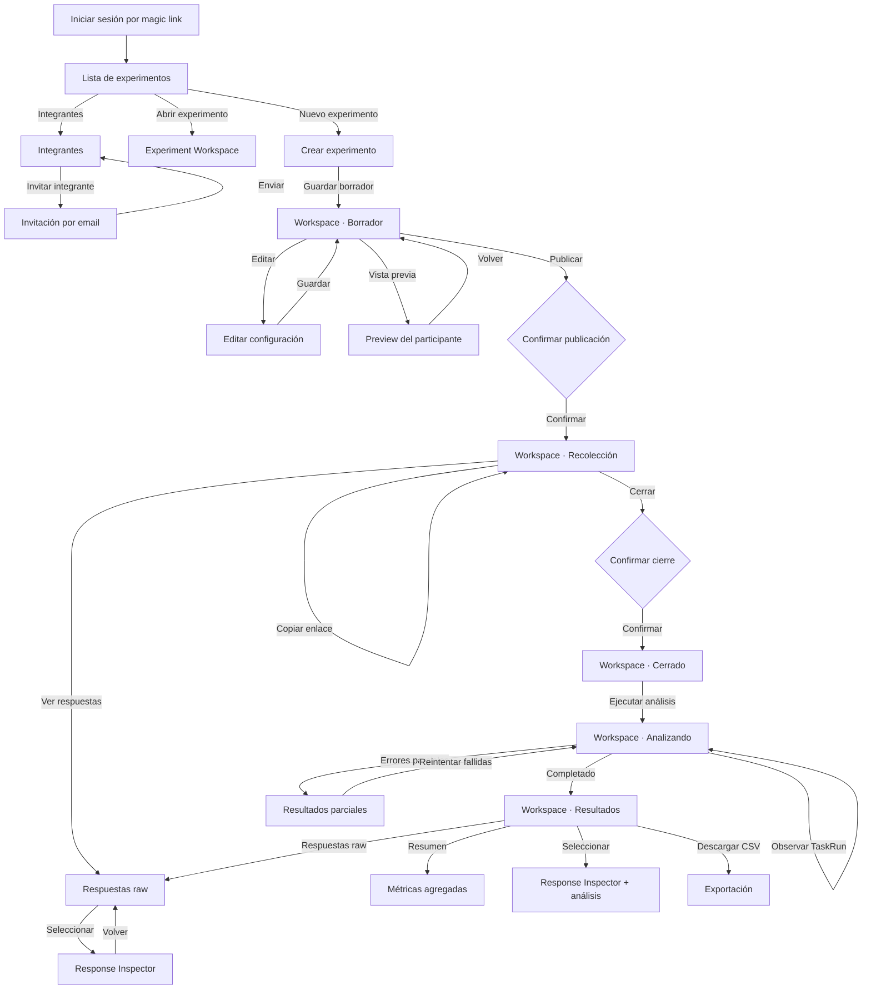
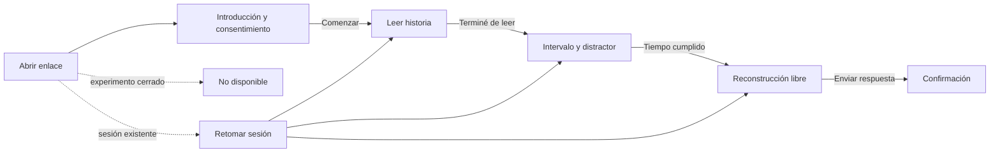

# Modelo de interacción

## Estructura principal

La aplicación administrativa se divide en tres niveles:

```text
Experiment List
    ↓ selecciona contexto
Experiment Workspace
    ↓ selecciona una participación
Response Inspector
```

- **Experiment List:** elegir o crear un experimento.
- **Experiment Workspace:** comprender su estado actual y ejecutar la próxima acción válida.
- **Response Inspector:** examinar una respuesta y su análisis sin perder el contexto.

## Mapa administrativo



## Proyección del workspace por estado

| Estado                 | Información principal       | CTA principal       | Acciones secundarias          |
| ---------------------- | --------------------------- | ------------------- | ----------------------------- |
| `draft`                | Configuración del protocolo | Publicar            | Editar, previsualizar         |
| `published`            | Progreso de recolección     | Cerrar recepción    | Copiar enlace, ver respuestas |
| `closed`               | Totales finales y raw data  | Ejecutar análisis   | Descargar CSV                 |
| `analyzing`            | Progreso durable            | Ninguno             | Ver respuestas                |
| `analyzed`             | Métricas y conclusiones     | Ver resultados      | Descargar, nueva corrida      |
| `analyzed_with_errors` | Resultados y fallas         | Reintentar fallidas | Ver resultados disponibles    |

## Flujo del participante



## CTA dominante

Cada vista tiene una única acción dominante:

```text
Lista              → Nuevo experimento
Crear/editar       → Guardar borrador
Borrador           → Publicar
Publicado          → Cerrar recepción
Cerrado            → Ejecutar análisis
Analizando         → observar, sin nueva acción dominante
Analizado          → Ver resultados
Introducción       → Comenzar
Lectura            → Terminé de leer
Intervalo          → habilitación automática
Reconstrucción     → Enviar respuesta
```

## Consideraciones de concurrencia

Como seis admins pueden abrir el mismo experimento:

- cada mutación valida el estado actual en el servidor;
- publicar o cerrar dos veces produce un rechazo convencional, no una segunda transición;
- la UI refresca el workspace después de una Operation;
- inicialmente no se ofrece edición colaborativa en tiempo real;
- `updatedAt` o una versión permiten detectar edición sobre un borrador desactualizado.
