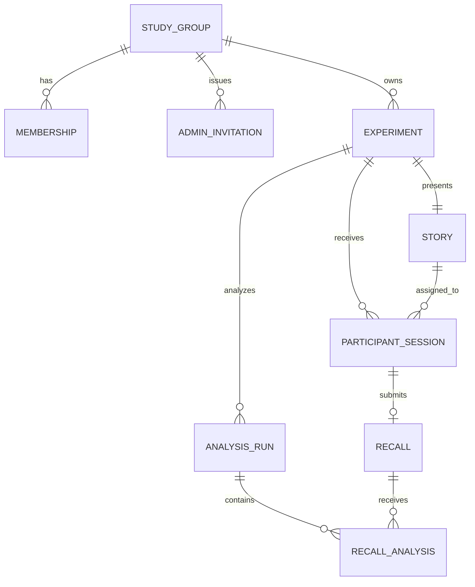

# Ontología

La ontología busca expresar el dominio sin depender de HTTP, Supabase, React o un proveedor de
modelos específico.

## Entidades

### StudyGroup

Agrupa a las personas que administran los experimentos. El MVP crea un único grupo mediante seed y
no expone una Operation para crear otros.

### Membership

Relaciona un usuario autenticado con el grupo.

```text
role: owner | admin | viewer
```

### AdminInvitation

Invitación dirigida a un email normalizado.

```text
status: pending | accepted | revoked | expired
role: admin | viewer
```

### Experiment

Raíz del agregado operativo.

```text
status: draft | published | closed | analyzing | analyzed | analyzed_with_errors
```

Pertenece al grupo, conserva quién lo creó y registra los actores de sus transiciones principales.

### Story

Material presentado al participante. Aunque el MVP permite exactamente una historia por
experimento, es una entidad separada para no impedir variantes futuras.

### ParticipantSession

Representa una participación anónima y mantiene la progresión temporal.

```text
status: created | reading | waiting | recalling | submitted | abandoned
```

Guarda la historia asignada, aunque en el MVP siempre será la única disponible.

### Recall

Respuesta textual original e inmutable de una sesión enviada.

### AnalysisRun

Corrida versionada de análisis de todas las respuestas incluidas en un snapshot del experimento.

```text
status: queued | running | completed | completed_with_errors | failed
```

### RecallAnalysis

Resultado del análisis de una respuesta dentro de una corrida. Registra proveedor, modelo, versión
de prompt y rúbrica, salida estructurada, uso y error eventual.

## Relaciones



## Operations

### Grupo

```text
StudyGroup.inviteMember
StudyGroup.revokeInvitation
StudyGroup.revokeMembership
AdminInvitation.accept
```

### Experimento

```text
Experiment.create
Experiment.updateDraft
Experiment.publish
Experiment.close
Experiment.analyze        durable
Experiment.retryAnalysis  durable
```

### Participación

```text
Experiment.join
ParticipantSession.finishReading
ParticipantSession.startRecall
ParticipantSession.submitRecall
```

## Queries y vistas

```text
StudyGroup.members
Experiment.list
Experiment.workspace
Experiment.collectionProgress
Experiment.responses
Experiment.results
Recall.detail
AnalysisRun.snapshot
```

## Invariantes principales

- Sólo owners invitan o revocan integrantes.
- Sólo admins y owners modifican experimentos.
- Viewers sólo consultan.
- Sólo un borrador puede editarse o publicarse.
- Sólo un experimento publicado admite nuevas sesiones.
- El contenido del protocolo no cambia después de publicar.
- Sólo un experimento publicado puede cerrarse.
- Sólo un experimento cerrado o previamente analizado puede iniciar una nueva corrida.
- Una sesión sólo puede enviar una respuesta.
- Una respuesta enviada es inmutable.
- Cada par `(analysisRun, recall)` tiene a lo sumo un resultado.
- Las métricas agregadas se derivan de resultados individuales persistidos.
